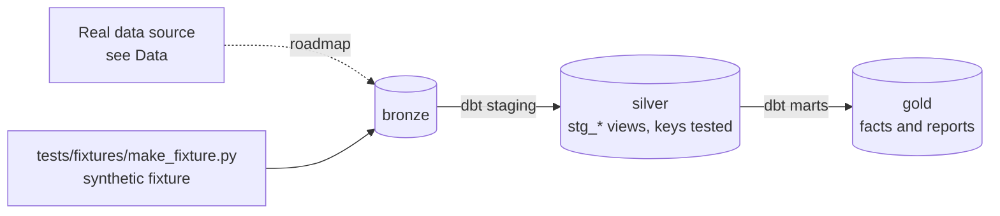

# Grid Assets GIS & Reliability (SAIDI/SAIFI)

[](https://github.com/Saigwe/grid-reliability-gis/actions/workflows/ci.yml)

> Feeder assets on a map, customers matched to the network, and the standard reliability indices (SAIDI and SAIFI) by feeder and month, with a hex map of the worst-served areas.

**Author:** Stanley Igwe, Lead Data (Analytics) Engineer · [Portfolio](https://saigwe.github.io)
**Stack:** PostGIS · GeoPandas · H3 · dbt Core · Kepler.gl or Streamlit maps · DuckDB spatial (CI)
**Status:** 🚧 Scaffolded. Fixture pipeline passes: `dbt build` 15/15. See [Roadmap](#roadmap).

Project 18 of my portfolio plan. At a Nigerian electricity distribution company I delivered GIS customer enumeration and asset mapping, and daily fault reporting. This repo rebuilds the problem on public and synthetic data. No employer or client data, code or logic is used.

---

## 90-second summary
| | |
|---|---|
| **Problem** | TODO: one sentence on the business problem. |
| **What I built** | TODO: fill in as the roadmap lands. |
| **Why it matters** | TODO: the decision this enables, in the user's words. |
| **Proof** | TODO: link to [Numbers](#numbers), with every claim reproducible. |

## Architecture


## Data
Real data: [OpenStreetMap](https://www.openstreetmap.org/) power lines and substations (Geofabrik extracts) and the [UK Power Networks open data portal](https://ukpowernetworks.opendatasoft.com/), with synthetic outage events. CI uses a synthetic feeders and outages fixture.

| Bronze table (fixture) | Rows |
|---|---|
| `bronze.feeders` | 40 |
| `bronze.outages` | 600 |

## Data model (gold layer, first cut)
| Model | Purpose |
|---|---|
| `rpt_reliability_monthly` | SAIDI (customer minutes interrupted per customer served) and SAIFI (interruptions per customer served). |
| `rpt_feeder_reliability` | Report model |

## Tests in place
- Staging: `unique` / `not_null` on every key, and `relationships` on every foreign key
- Marts: grain tests (`unique_combination`) and accepted values
- Business rules: `assert_customers_affected_within_feeder`

## Numbers
*(Fill from real runs. Never estimate.)*
| Metric | Value |
|---|---|
| Rows processed (real data) | _tbd_ |
| dbt models / tests | _tbd_ |
| `dbt build` runtime | _tbd_ |

## How to run
Requires **Python 3.12** (what CI uses) and `make`, or run the commands in the `Makefile` by hand.
```bash
python -m venv .venv && source .venv/bin/activate   # Windows: .venv\Scripts\activate
pip install -r requirements.txt
make fixture-all   # synthetic fixture -> dbt build (used in CI)
```

## Roadmap
- [x] Scaffold: synthetic fixture, staging with key tests, first marts and business-rule tests, CI
- [ ] Load OSM substations and lines for one city into PostGIS
- [ ] Map customers to the nearest feeder asset
- [ ] Outage model: SAIDI and SAIFI by feeder and month
- [ ] H3 hex map of the worst-served areas (Kepler.gl)
- [ ] Interactive map in the README and portfolio
- [ ] Fill in [Numbers](#numbers) and the [design doc](docs/design_doc.md)
- [ ] 3-minute Loom walkthrough

## Interview topics this project prepares
- Geospatial SQL and indexing
- Reliability metrics
- Nearest-neighbour joins
- Map visualisation

## Data and licence
- **Fixture:** synthetic, generated with a fixed seed by `tests/fixtures/make_fixture.py` from `fixture_spec.yml`. It describes no real company or person.
- **Real data:** see [Data](#data) for each source's own licence and terms.
- **Code:** MIT (see `LICENSE`).
