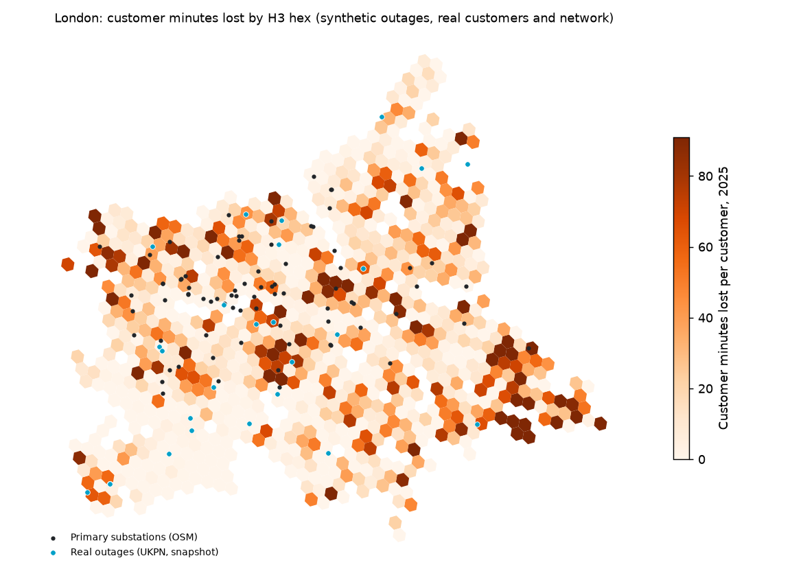

# Grid Reliability GIS: London

[](https://github.com/Saigwe/grid-reliability-gis/actions/workflows/ci.yml)

> London's electricity network from open data: OpenStreetMap substations and lines inside UK Power Networks' London operational zones, and 2.04 million Census 2021 households mapped to their nearest primary substation in British National Grid. SAIDI and SAIFI are computed by substation and month under the regulator's 3-minute rule, with an H3 hex map of the worst-served areas. Real UKPN outages are on the map too. The same spatial dbt models build on DuckDB and on PostGIS.

**Author:** Stanley Igwe, Lead Data (Analytics) Engineer · [Portfolio](https://saigwe.github.io)
**Stack:** Python · DuckDB spatial · PostGIS 3.4 · dbt Core (cross-database spatial macros, unit tests) · H3 · deck.gl / MapLibre · kepler.gl-ready CSV · GitHub Actions
**Status:** Core build complete on open London data. **[Open the interactive map →](https://saigwe.github.io/maps/london-grid-reliability/)**

Project 18 of my portfolio plan. At a Nigerian electricity distribution company I delivered GIS customer enumeration and asset mapping, and daily fault reporting. This repo rebuilds the problem on public and synthetic data. No employer or client data, code or logic is used.



---

## 90-second summary
| | |
|---|---|
| **Problem** | Reliability is reported per network, but customers live in streets. Operations need to see which substations and neighbourhoods are worst served, and the asset map is often incomplete. |
| **What I built** | A spatial pipeline that places every Census household on London's open network map and assigns it to the nearest primary substation (distances kept). It measures how complete the open map is against UKPN's own counts, computes the regulatory indices by substation and month, and paints them on an H3 hex map with the real outages on top. |
| **Why it matters** | It shows where to send maintenance money, and how much to trust the map before you do. |
| **Proof** | [Numbers](#numbers); the [map](https://saigwe.github.io/maps/london-grid-reliability/); CI builds everything on DuckDB and PostGIS. |

## Data
| Source | What | Real or synthetic |
|---|---|---|
| [OpenStreetMap](https://www.openstreetmap.org/) via Overpass | 4,007 substations and 819 lines and cables in the study area's bounding box | real |
| [UK Power Networks open data](https://ukpowernetworks.opendatasoft.com/) | London operational zones, network statistics, live faults, national outage feed | real |
| [ONS](https://geoportal.statistics.gov.uk/) / [Nomis](https://www.nomisweb.co.uk/) | 2021 LSOA population-weighted centroids; Census 2021 households (TS041) | real |
| `ingestion/simulate_outages.py` | Two years of outages (2024–2025) on the real customer-to-substation map | **synthetic** |

**Why the history is synthetic:** UKPN publishes live outages but no open fault history, and its asset registers (primary sites, secondary sites, cables) need a portal account. This project uses only what's open without one.

**What the simulation assumes:**
- 11 kV feeders are about 2,500 customers each.
- HV faults: 20% clear by auto-reclose in under 3 minutes; otherwise about 75% of customers are back in roughly 45 minutes and the rest after repair.
- LV faults hit 20–150 customers each.
- Planned works are kept out of the indices.
- Winter months are 20% worse than average.
- Rates are calibrated so London lands below UKPN's group-wide 2023/24 figures (37.6 interruptions per 100 customers, 29.0 minutes lost), because [UKPN reports London as its most reliable network](https://annualreview2024.ukpowernetworks.co.uk/operational-performance/network-reliability).

## How complete is the open map? (`rpt_network_coverage`)
| | OpenStreetMap | UKPN (published, London) | Coverage |
|---|---:|---:|---:|
| Primary substations (22–132 kV down to 11/6.6 kV) | 78 | 104 | 75% |
| Secondary substations | 1,276 | 20,415 | 6% |
| Customers: Census households vs UKPN customers | 2,039,005 | 2.4 million | 85% (UKPN's count includes businesses) |

Nearest-substation mapping is a proxy, because OSM has no feeder connectivity, and the gaps show:
- The median household is 1.4 km from its assigned primary, and the 95th percentile is 6.8 km.
- The busiest primary absorbs 149,740 households, against London's average of about 23,000 customers per primary. That's what happens when a neighbouring substation is missing from the map.

UKPN's own asset register would replace this proxy.

## Data model
| Model | Purpose |
|---|---|
| `stg_osm_substations` | OSM substations with a network level inferred from voltage tags: primary, grid, secondary, traction (excluded), unclassified. |
| `stg_lsoa_customers` | Census households at LSOA population-weighted centroids inside UKPN's London zones, in British National Grid. |
| `int_customer_feeder` | Each LSOA mapped to its nearest primary substation, with the distance. |
| `fct_interruption` | One row per outage, LSOA and restoration stage, flagging what counts under the 3-minute rule. |
| `rpt_reliability_monthly` | SAIFI and SAIDI per primary substation and month, quiet months included. |
| `rpt_feeder_reliability` | Annual CI per 100 customers and CML per primary, ranked, with the worst decile flagged. |
| `rpt_lsoa_reliability` | Reliability as each LSOA experienced it, the input to the hex map. |
| `rpt_live_outages` | Real UKPN outages placed on the network (nearest primary). |

Spatial SQL goes through macros (`dbt/macros/spatial.sql`) that compile to DuckDB spatial or PostGIS, with distances in metres in British National Grid (EPSG:27700).

## Tests
- **Unit test:** a 2-minute auto-reclose and planned works never count toward CI/CML, and restoration stages split customers (each counted once).
- **Reconciliation:** the outage, monthly and LSOA views add up to the same customer minutes and interruptions, and nothing is restored before it started.
- **Customers:** every household maps to exactly one primary, and no outage interrupts more customers than live in an LSOA.
- **Grain** tests on every mart. Hex outputs are valid H3 cells covering every household (pytest).
- **Portability:** the full dbt build passes on DuckDB and on PostGIS (Postgres 16, PostGIS 3.4) in CI.

## Numbers
From `make fetch all` on the open data (about 10 MB downloaded).

| Metric | Value |
|---|---|
| Customers | 2,039,005 households in 2,914 LSOAs, mapped to 76 primary substations (815 simulated 11 kV feeders) |
| dbt build | 34 nodes (9 tables, 6 views, 18 data tests, 1 unit test) in 2.2 s |
| London, 2025 (synthetic outages) | 22.4 interruptions per 100 customers, 23.3 minutes lost per customer (2024: 25.6 and 26.8) |
| By zone, 2025 | North West 26.1 min, North East 23.4, South 22.6, Central 16.9 |
| Short interruptions (excluded) | 91,632 customer interruptions under 3 minutes in 2025 |
| Worst-served primaries, 2025 | 8 primaries (the worst decile) serve 214,578 customers and lose 49–96 minutes each, against a median of 18 |
| Worst-served hexes, 2025 | 89 of 897 hexes (185,003 households) average 100 minutes, 4.3x London |
| Real outages on the map | 29 in the London zones at download time (7 from live faults, 22 from the national feed after de-duplicating an incident that appears in both) |

## Map
- **Interactive:** [saigwe.github.io/maps/london-grid-reliability](https://saigwe.github.io/maps/london-grid-reliability/) (source: [`map/index.html`](map/index.html)). It's built with deck.gl's H3 hexagon layer on a MapLibre base map, with substations and real outages as toggles and tooltips per hex.
- **kepler.gl:** drop [`results/hex_reliability.csv`](results/hex_reliability.csv) on [kepler.gl/demo](https://kepler.gl/demo) and it detects the `hex_id` column as H3 (kepler.gl is built on deck.gl).

## How to run
Requires **Python 3.12** (what CI uses) and `make`.
```bash
python -m venv .venv && source .venv/bin/activate   # Windows: .venv\Scripts\activate
pip install -r requirements.txt
make fetch && make all       # download, load, map customers, simulate outages, dbt, hex map, tests
make fixture-all             # a made-up city in the same file formats (CI)
make postgis-fixture         # then the same dbt project on PostGIS (set PGHOST, PGUSER, PGPASSWORD, PGDATABASE)
```

## Roadmap
- [x] Scaffold: fixture, staging with key tests, first marts, CI
- [x] Load OSM substations and lines for one city (London); the same models build on PostGIS
- [x] Map customers (Census households) to the nearest feeder asset, with distances and a coverage check against UKPN's counts
- [x] Outage model: SAIDI and SAIFI by primary substation and month, under the 3-minute rule
- [x] H3 hex map of the worst-served areas (deck.gl; kepler.gl-ready CSV)
- [x] Interactive map in the README and portfolio
- [ ] UKPN asset registers (needs a free portal account) to replace nearest-substation with real connectivity
- [ ] Collect UKPN's live outage feed on a schedule to build a real fault history
- [ ] 3-minute Loom walkthrough ([script ready](docs/walkthrough.md))

## Interview topics this project prepares
- Spatial SQL: projections (WGS84 vs British National Grid), point-in-polygon, nearest neighbour, H3
- Reliability indices (SAIDI, SAIFI, CI, CML) and the regulatory rules behind them
- Judging open data: coverage checks before conclusions
- Writing SQL that runs on two engines

## Data and licence
- **OpenStreetMap:** © OpenStreetMap contributors, ODbL.
- **UK Power Networks open data:** under UKPN's open data licence.
- **ONS / Census 2021:** Open Government Licence v3.0.
- **Outage history and CI fixture:** synthetic, fixed seeds.
- **Code:** MIT (see `LICENSE`).
